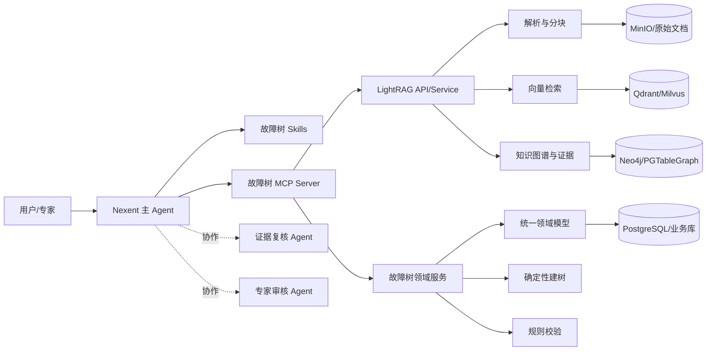

# LightRAG 故障树项目迁移到 Nexent 分析

## 结论

推荐采用“**Nexent 编排层 + LightRAG 知识层 + 故障树领域服务层**”的迁移方式：

- Nexent 负责 Agent 对话、任务编排、资源管理、会话记忆、权限和评测。
- LightRAG 继续负责文档解析、分块、混合检索、知识图谱和证据查询。
- 故障事件抽取、AND/OR 建树、结构校验保持为确定性领域能力。
- 通过 MCP 暴露稳定工具，通过 Skill 沉淀领域规范和修复策略。
- 第一阶段不要重写 LightRAG 存储层，也不要让 Agent 直接操作数据库。

本项目需要迁移的核心能力不是 LightRAG WebUI，而是：

```text
设备文档 -> 文档解析/分块 -> 混合检索 -> 故障事件与因果关系抽取
        -> 有向知识图谱 -> 故障树投影 -> 规则校验 -> 人工审核/回写
```

## 1. 从现有材料读到的目标

现有方案和问题清单已经明确以下边界：

- 保留 LightRAG 的检索、图谱、文档处理和故障树基础，不做推倒重来。
- 用户在 Nexent 中指定顶事件，系统检索证据并生成可编辑故障树。
- Agent 负责分析、局部修复和专家辅助，确定性工具负责建树与校验。
- 每个节点和关系都要关联文档、章节、Chunk 和原文证据。
- MCP 工具与 Skill 需要可复用，并能够适配其他工业设备，而不是只适用于单一案例。
- 最终形成“生成、编辑、校验、审核、发布、评测”的闭环。

## 2. LightRAG 项目结构

| 目录或模块 | 作用 | 迁移价值 |
| --- | --- | --- |
| `lightrag/lightrag.py` | `LightRAG` 总入口，负责初始化、文档插入、查询、Graph CRUD、状态查询 | 高。通过少量公开方法封装 MCP 工具。 |
| `lightrag/pipeline.py` | 文档入库、解析、多模态分析、分块、抽取、写图、失败恢复和调度 | 高。保留为知识入库服务。 |
| `lightrag/operate.py` | 检索、关键词提取、实体/关系抽取、图合并、`local/global/hybrid/mix/naive` 查询 | 高。检索与抽取核心。 |
| `lightrag/parser/` | native、legacy、MinerU、Docling 解析和文件路由 | 高。复用多格式及多模态资产解析。 |
| `lightrag/chunker/` | 固定长度、递归字符、语义向量、段落语义分块 | 高。适合手册、表格和章节化工业文档。 |
| `lightrag/kg/` | KV、Vector、Graph、Doc Status 存储后端及并发控制 | 中高。保留接口，生产环境切 PostgreSQL/Neo4j/Qdrant 等。 |
| `lightrag/llm/` | OpenAI、Ollama、Gemini、Bedrock 等模型适配 | 中。Nexent 已统一模型管理时，多数无需迁移。 |
| `lightrag/llm_roles.py` | EXTRACT、KEYWORD、QUERY、VLM 角色配置 | 中。设计思想可复用，模型配置交给 Nexent。 |
| `lightrag/prompt.py` | 通用实体关系抽取与查询提示词 | 中。不能直接满足 FTA 语义，需要领域化。 |
| `lightrag/addon_params.py` | 语言、实体类型引导、分块参数等运行时配置 | 高。可作为实例级领域配置入口。 |
| `lightrag/utils_graph.py` | 实体/关系编辑、合并、删除和来源追踪 | 中高。只把受控的查询和候选写入封装给 Agent。 |
| `lightrag/api/` | FastAPI 服务、鉴权、文档/查询/图谱路由 | 中。适合作为 MCP 后端，不建议把全部 API 暴露给 Agent。 |
| `lightrag_webui/` | 文档管理、图谱浏览、检索调试和普通问答界面 | 低到中。Nexent 已提供主交互界面。 |
| `tests/` | Core、API、存储、流水线和解析测试 | 高。迁移工具契约和回归用例。 |
| `scripts/`、部署文件 | 环境初始化、测试、Docker/Kubernetes | 参考即可。Nexent 有独立部署体系。 |

### 2.1 四类存储

- KV：文档、Chunk、LLM 缓存和抽取中间结果。
- Vector：Chunk、实体和关系的向量。
- Graph：实体关系图。
- Doc Status：文档解析、处理、失败、重试和调度状态。

本地默认使用 JSON/Nano/NetworkX，适合测试。生产优先 PostgreSQL 一体化；规模变大后可按 PostgreSQL + Qdrant/Milvus + Neo4j 拆分。

### 2.2 查询模式

- `local`：实体及其邻域的精确检索。
- `global`：跨文档的关系和主题检索。
- `hybrid`：本地与全局结合。
- `naive`：仅向量检索原始 Chunk。
- `mix`：图谱与向量综合，适合故障树证据召回。

## 3. 故障树参考项目结构

`FT_LightRAG_Flyfish-main` 在 LightRAG 上的有效增量集中在：

| 模块 | 现有作用 | 处理建议 |
| --- | --- | --- |
| `lightrag/fault_tree/prompts.py` | 定义顶事件、中间事件、底事件、`resultsIn`、`jointly_resultsIn` 和 AND 组合示例 | 迁入 Nexent Skill 和版本化 Prompt 模板。 |
| `lightrag/fault_tree/schemas.py` | 故障树三元组模型 | 演进为统一 `FaultEvent / FaultRelation / FaultTreeDraft`。 |
| `lightrag/fault_tree/builder.py` | 图谱转故障树、引用构建、导出摘要 | 适配后作为确定性 `project_fault_tree` MCP 工具。 |
| `lightrag/fault_tree/validation.py` | 环检测、层级、孤立节点、门连接和 KG 一致性校验 | 高价值复用，封装为 `validate_fault_tree`。 |
| `/query/fault-tree-json` | 检索后生成故障树三元组 | 改造为 `extract_fault_knowledge`，不复用旧响应契约。 |
| `/graph/fault-tree/export` | 从图谱导出故障树 | 合并进 `project_fault_tree`。 |
| React/Vue 故障树编辑器 | 可视化、编辑、导出和校验结果展示 | 可作为独立工具页或后续前端，不直接迁入 Nexent Chat。 |
| 故障树测试和回归脚本 | 校验生成与结构规则 | 保留并转成 MCP 工具回归测试。 |

## 4. 可直接复用的 LightRAG 能力

| 能力 | 推荐入口 | Nexent 中的工具边界 |
| --- | --- | --- |
| 文档入库 | `LightRAG.ainsert()`、`/documents/upload`、`/documents/text` | `ingest_document(file_ref, workspace, process_options)` |
| 处理进度 | `LightRAG.get_processing_status()`、文档状态接口 | `get_ingestion_status(track_id)` |
| 混合检索 | `LightRAG.aquery_data()`、`/query/data` | `search_fault_context(query, top_event, max_chunks)` |
| 局部子图 | `LightRAG.get_knowledge_graph()` | `query_subgraph(top_event, max_depth, max_nodes)` |
| 实体详情 | `LightRAG.get_entity_info()` | `get_entity_evidence(entity_id)` |
| 关系详情 | `LightRAG.get_relation_info()` | `get_relation_evidence(relation_id)` |
| 图标签发现 | `LightRAG.get_graph_labels()` | 可作为内部检索辅助，不必单独开放。 |
| 文档解析 | `lightrag/parser/` | 只通过入库工具间接调用。 |
| 分块 | `lightrag/chunker/` | 只通过 `process_options` 或入库参数控制。 |
| 领域实体类型 | `addon_params` 的 `entity_types_guidance` | 由 Skill 提供并按知识库版本绑定。 |
| 抽取质量钩子 | `kg_extraction_validator` | 可接故障事件、关系枚举、证据字段校验。 |

推荐优先调用 LightRAG REST API，而不是让 MCP 服务直接嵌入 LightRAG SDK。REST 边界更稳定，也能隔离数据库连接和并发控制。

## 5. 适配后复用的领域能力

### 5.1 统一领域模型

先建立一份 MCP 与 Agent 共用的数据合同：

```text
FaultEvent
  id, name, type(top/intermediate/basic), description
  evidence[], confidence, source_documents[], review_status

FaultRelation
  source_event_id, target_event_id, relation_type
  gate_type(AND/OR), evidence[], confidence, direction_source

FaultTreeDraft
  top_event_id, nodes[], gates[], references[]
  validation_result, version, review_status
```

三元组保存事实，故障树保存逻辑结构。两者之间必须经过确定性投影，不能让 Agent 自由拼装正式树。

### 5.2 抽取

可复用 `operate.py` 的批量 Chunk 抽取、LLM 并发、缓存和图合并能力，但需要替换或约束以下语义：

- 实体类型限定为 `TopEvent / IntermediateEvent / BasicEvent / Asset / Component / FaultMode / MaintenanceAction` 等本体类型。
- 关系类型限定为 `resultsIn / jointly_resultsIn / partOf / conditionOf / similarTo / contradicts`。
- 每条关系保存 `source_event_id`、`target_event_id`、`gate_type` 和证据。
- 抽取结果先进入候选层，不直接写正式图。
- `kg_extraction_validator` 负责拒绝未知类型、自环、无证据和维修措施误作原因。

### 5.3 故障树投影

复用现有 `builder.py` 的图遍历、顶事件解析和引用构建，但修改两个前提：

- 因果方向来自结构化字段，不再通过 BFS 距离和事件类型猜测。
- AND/OR 来自 `gate_type`，不再从 `keywords` 字符串中扫描 `resultsIn`。

`project_fault_tree` 应是纯计算工具，输入显式 `top_event` 和结构化关系，输出 `FaultTreeDraft`。

### 5.4 规则校验

现有 `validation.py` 的结构校验可直接保留：

- 重复节点/边、缺失端点和自环。
- 唯一顶事件、顶事件无父节点、底事件无子节点。
- 逻辑门父子关系、事件层级倒置。
- 有向环检测、从顶事件的可达性。
- 与知识图谱的一致性检查。

规则错误由工具返回，Skill 只负责解释错误和决定局部修复策略。

## 6. 不建议直接迁移的部分

- LightRAG 的完整 React 管理端、登录和用户管理：Nexent 已提供对应能力。
- LightRAG 的 Gunicorn、Docker、Kubernetes 部署入口：避免维护两套平台生命周期。
- 默认 JSON/Nano/NetworkX 生产运行方式：只适合本地测试。
- `BaseGraphStorage`、VDB、KV 等底层对象：不能暴露给 Agent 或 MCP。
- 删除、清空、批量改图、密码和迁移 CLI：不进入普通 Agent 工具集。
- 现有三套重复前端和不存在后端的死接口：直接淘汰。
- LLM Provider 适配层：若 Nexent 已统一模型管理，仅保留 OpenAI 兼容接入口即可。
- 旧 `/query/fault-tree-json` 契约：保留内部逻辑，但替换成新的统一领域工具。

## 7. Nexent 中的目标架构



职责边界：

- Agent 决定下一步调用哪个工具，不直接解释底层图数据库结果。
- Skill 提供抽取规范、本体、建树规则、校验解释和审核策略。
- MCP Server 负责参数校验、租户/workspace 隔离、超时、错误码和审计。
- LightRAG 和故障树服务负责实际计算与持久化。

## 8. 建议构建的 Agent

第一版只保留一个主 Agent 和两个协作 Agent，避免流程过度复杂。

| Agent | 职责 |
| --- | --- |
| 工业故障树主 Agent | 接收设备文档和顶事件，依次调用入库、检索、抽取、建树、校验和审核工具。 |
| 证据复核 Agent | 检查节点和关系是否有原文支持，定位方向冲突、同义实体和缺失中间事件。 |
| 专家辅助 Agent | 解释故障树、提出局部修改建议，将修改保存为待审核变更。 |

Nexent 已支持 A2A 子 Agent 和内部协作 Agent。主 Agent 负责最终输出，子 Agent 只处理受限任务并返回结构化结果。

## 9. 建议构建的 MCP 工具

工具应围绕业务能力组织，不能一个内部函数对应一个工具。

| 工具 | 类型 | 作用 |
| --- | --- | --- |
| `ingest_document` | 异步写入 | 将 Nexent 文件引用写入指定 LightRAG workspace。 |
| `get_ingestion_status` | 只读 | 返回解析、抽取和入库进度。 |
| `search_fault_context` | 只读 | 返回 Chunk、实体、关系、引用和截断标志。 |
| `query_subgraph` | 只读 | 从指定顶事件召回有界子图。 |
| `get_evidence` | 只读 | 返回节点或关系对应的文档、章节、Chunk 和原文。 |
| `extract_fault_knowledge` | 候选计算 | 按领域本体抽取候选事件和关系，不直接发布。 |
| `project_fault_tree` | 确定性计算 | 从结构化事件和关系生成故障树草稿。 |
| `validate_fault_tree` | 确定性计算 | 执行结构、逻辑、证据和图中一致性校验。 |
| `save_fault_tree_draft` | 状态写入 | 保存可编辑草稿和版本。 |
| `submit_review` | 人工确认 | 保存接受、修改、拒绝及审核理由。 |

第一批只开放 `search_fault_context`、`query_subgraph`、`get_evidence`、`project_fault_tree` 和 `validate_fault_tree`。等方向与门类型修复后再开放正式图写入。

MCP 工具参数中可声明 `tenant_id`、`user_id`、`user_groups`，由 Nexent 自动注入可信用户信息，用于 workspace 和权限隔离。

## 10. 建议构建的 Skill

Skill 的重点是方法和规范，不是承载实际计算。

| Skill | 内容 |
| --- | --- |
| `industrial-fault-extraction` | 设备/部件/故障模式本体、事件类型、关系枚举、证据和 JSON 输出规范。 |
| `fault-tree-modeling` | 单一因果与 AND 组合、逻辑门规则、层级规则、顶事件约束。 |
| `fault-tree-validation` | 如何解读环、孤点、门度、方向冲突和证据缺失，以及局部修复边界。 |
| `expert-review` | AI 建议必须进入 `pending_review`，不直接覆盖正式知识。 |
| `fault-tree-evaluation` | 评测集、关系方向准确率、门类型准确率、证据覆盖率和失败案例归档方法。 |

Skill 可以使用 Nexent 的渐进式披露，只在主 Agent 确认需要时加载完整规则和示例。

## 11. 代码复用清单

| 优先级 | 复用对象 | 方式 |
| --- | --- | --- |
| P0 | `LightRAG.aquery_data()` | 包装 `search_fault_context`。 |
| P0 | `LightRAG.get_knowledge_graph()` | 包装 `query_subgraph`。 |
| P0 | `get_entity_info()` / `get_relation_info()` | 包装证据工具。 |
| P0 | `fault_tree/validation.py` | 包装规则校验工具。 |
| P0 | `fault_tree/prompts.py` | 重构为领域 Skill。 |
| P0 | 故障树回归测试 | 作为 MCP 工具验收测试。 |
| P1 | `pipeline.py`、`parser/`、`chunker/` | 保留文档处理服务。 |
| P1 | `fault_tree/builder.py` | 修改方向与门字段后用于投影。 |
| P1 | `lightrag/addon_params.py` | 注入领域实体类型和分块策略。 |
| P1 | `kg_extraction_validator` | 增加领域抽取约束。 |
| P1 | `utils_graph.py` | 仅开放候选层和受控审核写入。 |
| P2 | `kg/` 存储后端 | 保留接口，生产切换外部数据库。 |
| P2 | `lightrag/evaluation/` | 参考指标设计，领域评测另建。 |

## 12. 迁移前必须修复的领域问题

以下问题若不先处理，直接套 Nexent 只会把错误流程 Agent 化：

1. **因果方向丢失。** 当前后端存在无向边和字母序重排，必须改成有向边或把方向存成一等字段。
2. **AND/OR 门未结构化。** 必须增加 `gate_type`，不能继续从关键词文本推断。
3. **顶事件不是显式输入。** `project_fault_tree` 必须要求用户提供 `top_event_id` 或明确名称。
4. **证据链不完整。** 每个节点和关系至少保存文档、Chunk、原文引用和页码等可得信息。
5. **静默降级。** 图谱未命中而改用纯 LLM 生成时，必须返回 `source=llm` 和警告。
6. **静默截断。** 子图必须返回 `truncated=true`，Agent 不得把截断结果当完整树。
7. **置信度硬编码。** 应根据证据、规则、跨文档一致性和独立复核计算。
8. **模型与编辑器模型不统一。** 三元组、图节点和故障树门必须经过统一领域模型。

## 13. 建议实施顺序

1. **统一模型和证据格式。** 定义 `FaultEvent`、`FaultRelation`、`FaultTreeDraft`，修复方向与 `gate_type`。
2. **搭建 MCP Server。** 先接只读检索、子图、证据、确定性建树和校验。
3. **沉淀 Skill。** 把 FTA 本体、抽取规范、建树规则、校验解释和审核规则版本化。
4. **配置 Nexent Agent。** 主 Agent 用 `max_steps` 限制流程，证据复核和专家辅助作为协作 Agent。
5. **打通草稿与审核。** 工具保存 `draft_id`，Agent 只提出待审核变更，专家确认后发布。
6. **建立评测。** 固定电机、泵等至少两类设备样本，比较事件 F1、方向准确率、门类型准确率、证据覆盖率和人工采纳率。

## 14. 关键边界

- Nexent 是编排和交互平台，不能替代故障树领域建模。
- LightRAG 是知识处理和检索引擎，不应被改造成 Agent 运行时。
- MCP 是能力合同，不应暴露数据库句柄或内部 Python 对象。
- Skill 是规则和流程知识，不应替代确定性算法。
- Agent 只提出候选和修改建议，正式知识必须经过规则校验与人工审核。

## 参考材料

- [Nexent 软件架构](../nexent/doc/docs/zh/getting-started/software-architecture.md)
- [Nexent Skill 系统](../nexent/doc/docs/zh/backend/skills/overview.md)
- [Nexent MCP 工具开发](../nexent/doc/docs/zh/backend/tools/mcp.md)
- [Nexent NL2Agent 设计交接](../nexent/docs/handoffs/2026-08-17-nl2agent-capability-design-handoff.md)
- [Nexent 病理项目架构示例](../nexent/pathology-ai/architecture.md)
- [故障树项目重构初步方案](../学习资料/FT_LightRAG_Flyfish-main/project_docs/Nexent重构初步方案.md)
- [故障树项目问题清单](../学习资料/FT_LightRAG_Flyfish-main/project_docs/问题清单.md)
- [Nexent 底层工具代码清单](../学习资料/FT_LightRAG_Flyfish-main/project_docs/Nexent底层工具代码清单.md)
- [AgentArts 与 Nexent 选型建议](../学习资料/FT_LightRAG_Flyfish-main/project_docs/AgentArts与Nexent选型及项目重构建议.md)
